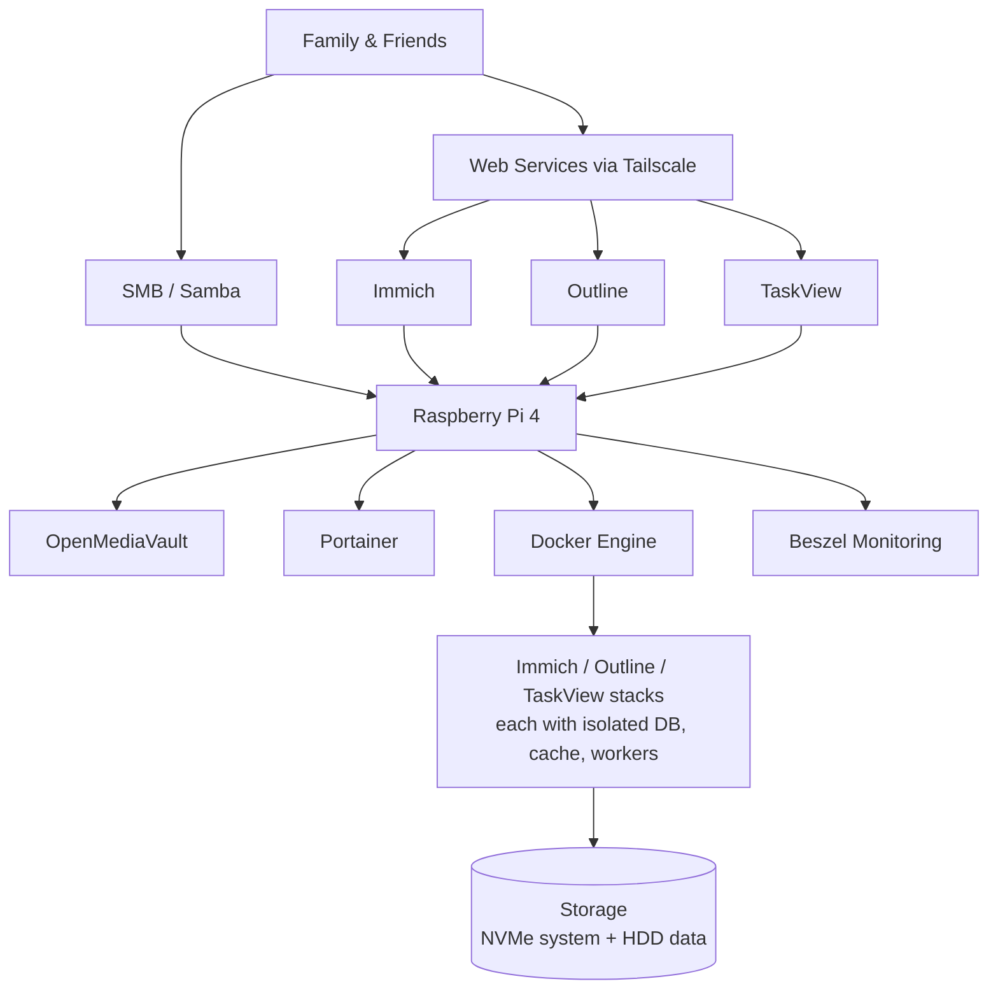

# PiCloud

> A self-hosted personal cloud on a Raspberry Pi 4 — private file storage, photo management, and collaborative tools for family and friends.

PiCloud is a private alternative to Google Drive, Google Photos, and Notion, built to keep full ownership of personal data while running on low-power hardware. It combines SMB file sharing, Immich for photos, Outline for documentation, and TaskView for task management — all containerized, all accessible over an encrypted private network, and none of it exposed to the public internet.

---

## Why

Cloud providers are convenient, but they own your data, your photos, and your documents. PiCloud was built around a simple principle:

> Personal cloud infrastructure should be private, understandable, maintainable, and fully controlled by its owner.

Rather than maximizing features, the project prioritizes simplicity, reliability, long-term maintainability, and complete data ownership.

---

## Stack at a glance

| Layer | Component |
|-------|-----------|
| Hardware | Raspberry Pi 4 Model B (4 GB RAM) |
| OS | Debian 13 (Trixie) |
| NAS / admin | OpenMediaVault |
| Container management | Portainer + Docker Engine |
| Photos | Immich |
| Knowledge base | Outline |
| Tasks | TaskView |
| File sharing | Samba |
| Remote access | Tailscale (`tailscale serve`) |
| Identity / SSO | `tsidp` (Tailscale OAuth IDP) |
| Monitoring | Beszel |
| Storage abstraction | MergerFS |

---

## Architecture



Each service runs its own isolated stack. No service shares state with another.

For the full architecture — hardware, storage layout, network, firewall rules, port ranges and design decisions — see [docs/architecture.md](docs/architecture.md).

---

## Features

- **Private file storage** over SMB, available on LAN and tailnet
- **Self-hosted photo management** with Immich (Google Photos replacement)
- **Collaborative knowledge base** with Outline
- **Task and project management** with TaskView
- **Single sign-on** across all user-facing services via `tsidp`
- **Encrypted remote access** with Tailscale — no port forwarding, no public exposure
- **Automatic HTTPS** certificates for every service
- **Centralized administration** with OpenMediaVault and Portainer
- **Real-time monitoring** via Beszel, SMART, Docker health checks, and OMV notifications

---

## Prerequisites

To replicate or adapt this setup:

- Raspberry Pi 4 (at least 4 GB RAM)
- Debian 13 (Trixie) or Raspberry Pi OS
- Docker Engine
- Tailscale
- A Tailscale tailnet with ACLs configured
- `tsidp`

`tsidp` is an experimental component. See [Known Risks](#known-risks).

---

## Repository structure

```
.
├── README.md
├── LICENSE
└── docs/
    ├── architecture.md        (The general technical index)
    ├── hardware.md            (Physical details, discs, energy)
    ├── networking.md          (Tailscale, ACLs, ports)
    ├── security.md            (Firewall, Docker isolation, risks)
    └── services.md            (What each container does)
```

---

## Known Risks

- **`tsidp` is experimental (WIP).** Tailscale marks it as under active development and subject to breaking changes. SSO depends on it; if it breaks, each service must fall back to local authentication. This fallback is not currently automated.
- **Single HDD, no redundancy today.** Data loss is possible if the disk fails before SnapRAID is in place.
- **No UPS.** Sudden power loss can interrupt writes.

---

## Roadmap

**Storage & backups**
- [ ] Add a second HDD (same size or larger) dedicated to backups
- [ ] Deploy SnapRAID for parity across data disks
- [ ] Implement automated backups with restic or borg
- [ ] Add monthly restore verification

**Operations**
- [ ] Document disaster recovery procedures
- [ ] Add UPS

**Services**
- [ ] Evaluate additional collaborative tools

---

## License

[MIT](LICENSE) — adapt freely, attribution appreciated.

---

## Acknowledgements

[OpenMediaVault](https://www.openmediavault.org/) | [Portainer](https://www.portainer.io/) | [Immich](https://immich.app/) | [Outline](https://www.getoutline.com/) | [TaskView](https://github.com/Gimanh/taskview-community) | [Beszel](https://beszel.dev/) | [Tailscale](https://tailscale.com/) | [MergerFS](https://github.com/trapexit/mergerfs) | [Docker](https://www.docker.com/)
